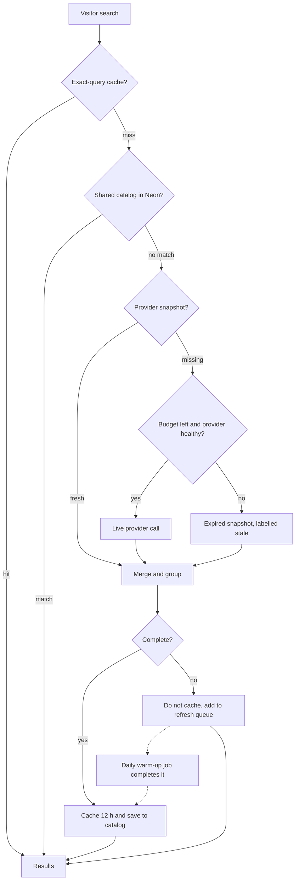

# Outlet Radar

A multi-brand product discovery and price-comparison site for sneakers, apparel and accessories. Search by model, browse catalogs from StockX, GOAT, Flight Club, Kicks Crew, Nike.com and Google Shopping merchants (such as Foot Locker, Champs Sports and JD Sports), and compare each product's online listings side by side, including offers from many other stores and brand sites.

Built with Next.js 15, Vercel and Neon Postgres, and designed to keep working on **free plans**: results are cached and shared between visitors, provider usage is capped by atomic daily and monthly budgets, and a search is never left blank when a free allowance runs out.

> **Limitations:** the catalog is a discovery index, not a complete product master. A catalog record is not proof of a current listing or of size-level availability, and the app does not claim physical-store inventory. Always confirm price, size and availability on the seller's page.

**Contents:** [What it does](#what-it-does) · [How it works](#how-it-works) · [Setup](#setup) · [Environment variables](#environment-variables) · [Affiliate links](#affiliate-links) · [Bulk feed ingestion](#bulk-feed-ingestion) · [Operating it](#operating-it) · [Updating](#updating) · [API routes](#api-routes) · [Project structure](#project-structure) · [Docs and changelog](#docs-and-changelog) · [Data and license](#data-and-license)

## What it does

- **Structured discovery.** Choose an item type, optional brand, audience and release year, and describe the model (at least two characters). Shorthand such as `aj1`, `af1` or `nb 550` is understood.
- **Local refinements.** Size, color, price range and sale-only filter the results already on screen; they never spend provider credits.
- **Accurate sizes with prices.** Sizes are matched within a US scale decided by the **Gender** control (men's, women's, kids'); men's and women's sizes are converted only for brands with a known chart (Nike, Jordan, New Balance, adidas) and labelled as converted. With a size entered, each card lists the price from every seller that has that size, lowest first: marketplace asks from StockX, GOAT and Flight Club (verified) and retailers whose listing includes the size (stock unconfirmed). Only the selected size is shown.
- **Saved searches.** Save a search (with its filters and size) in your browser; running it again reports price drops since you last checked. Nothing is stored on the server.
- **Grouped products.** Listings from different retailers that describe the same model are combined into one card. Conflicting known year, audience or color keeps variants apart.
- **Exact-product comparison.** **Compare offers** expands a card to show that model's direct retailer listings: seller title, price, size signals and product link. With a Channel3 key it also adds offers from many other stores and brand sites (adidas, New Balance, Puma, Reebok, Vans, Foot Locker and more), with eBay keys it adds new fixed-price eBay listings, and with Impact keys it adds affiliate-linked offers from the brands and stores that approved your account. Similar-but-different models are excluded.
- **Never an empty page.** If a source is out of free lookups, paused or failing, saved results are shown with a clear notice and the search is queued for an automatic refresh.
- **Watchlist.** Save products. The daily price-history job currently tracks Nike URLs only; other saved links are kept but not refreshed.
- **Owner dashboard.** `/admin/providers` shows provider budgets, health, the refresh queue, catalog counts, which retailers have actually appeared in results, a one-click live connection test of every configured provider, and anonymous counts of which stores and products visitors click.

## How it works



**Lookup layers.** Every search checks, in order: the exact-query cache (12 h), the shared normalized catalog (`canonical_products`, `retailer_offers`, `retailer_offer_sizes`), provider snapshots (24 h per PCKT source, 12 h for Nike.com, 6 h for Google Shopping), and finally live providers. A search answered from the shared catalog that is missing a fresh snapshot for a configured source is queued so the warm-up job can add the missing retailers. A product found by one visitor is reusable by all.

**Budgets.** Before any paid request, an atomic Postgres function (`reserve_retailer_api_budget`) reserves daily and monthly units together, so concurrent requests cannot overspend. Defaults: PCKT 15/day and 450/month, SerpApi 7/day and 200/month, API.SH 25/day and 1,000/month, Channel3 30/day and 900/month, eBay 3,000/day. A shared request gate keeps PCKT under its 1 request/second limit across Vercel instances. A provider that fails repeatedly is paused with exponential back-off while the others keep working.

**Cost control.** Browsing always queries StockX and GOAT (0.7 PCKT credits); Flight Club and Kicks Crew (1.5) run only while at least half of the day's allowance remains. Gender, size, color, price and sale are applied locally. Comparing a product reuses the retailer URLs already grouped with it and runs no broad search; the only live calls are one optional search each to Channel3, eBay and Impact, each cached for 3 hours and never saved to the catalog (both providers ask that offer data not be kept longer).

**Many visitors.** Complete search answers are cached at the CDN for 10 minutes, so identical searches never reach the server. The browser anonymously reports each search (filters and lowercase words only) and the daily warm-up refreshes the most-searched filters first. See [docs/scaling.md](./docs/scaling.md).

**Protecting the shared allowance.** A connection that triggers more than `LIVE_LOOKUPS_PER_HOUR` fresh provider lookups in an hour is still answered, from saved results, so one runaway visitor cannot use up everyone's daily credits. The counts live only in server memory.

**Keeping results fresh.** Incomplete answers are never cached. They go into `catalog_refresh_queue`, and a daily job (`/api/cron/warm-catalog`) completes them, then refreshes popular searches from `lib/warm-seeds.ts`, using at most 40% of the day's budget.

**Sizes.** The size filter compares US sizes within one scale and never guesses: a bare "10" counts as men's only for a men's search, UK/EU labels are ignored, and conversion is limited to Nike, Jordan, New Balance and adidas. A size is *verified* only when StockX, GOAT or Flight Club reports an active ask for it; a retailer-listed size is shown as unconfirmed. Every seller that has the size gets one price row (lowest first), and the price filter uses those prices.

**Size data** is demand-driven: a size refinement triggers one batched StockX/GOAT lookup (up to 20 products), and Compare offers checks the selected product. Only explicit provider signals are stored as available or unavailable; everything else stays *unverified*.

More detail: [docs/free-tier-operations.md](./docs/free-tier-operations.md).

## Stack

- Next.js 15, React 19, TypeScript
- Vercel (hosting and Cron)
- Neon serverless Postgres
- [PCKT](https://pckt.sh/): StockX, GOAT, Flight Club and Kicks Crew catalogs
- [SerpApi](https://serpapi.com/): Google Shopping merchants (optional)
- [API.SH](https://api.sh/): Nike.com listings in the catalog, legacy Nike endpoints and Nike price history (optional)
- [Channel3](https://trychannel3.com/): live cross-store offers in Compare (optional)
- [eBay Browse API](https://developer.ebay.com/): live new eBay listings in Compare (optional)
- [Impact](https://impact.com/) partner API: affiliate-linked brand and store offers in Compare (optional)

## Setup

### 1. Create the database (Neon)
1. Create a Neon project and copy its **pooled** connection string.
2. Open **SQL Editor** and run the whole of [`db/schema.sql`](./db/schema.sql). It is idempotent and creates every table and function, including the budget ledger and refresh queue.

### 2. Get provider keys (all optional, but PCKT is needed for the marketplace catalog)
| Key | Where | Enables |
|---|---|---|
| `PCKT_API_KEY` | [pckt.sh](https://pckt.sh/) free account | StockX, GOAT, Flight Club and Kicks Crew discovery and comparison |
| `SERPAPI_API_KEY` | [serpapi.com](https://serpapi.com/) free account | Google Shopping merchants such as Foot Locker and Champs |
| `API_SH_KEY` | [api.sh](https://api.sh/) | Nike.com listings in the catalog, legacy Nike search and the Nike price-history job |
| `CHANNEL3_API_KEY` | [trychannel3.com](https://trychannel3.com/) free account | Offers from many other stores and brand sites when you press Compare offers |
| `IMPACT_ACCOUNT_SID`, `IMPACT_AUTH_TOKEN` | Impact dashboard → Account Settings → API | Affiliate-linked offers from the brands and stores that approved your Impact account |
| `EBAY_CLIENT_ID`, `EBAY_CLIENT_SECRET` | [developer.ebay.com](https://developer.ebay.com/) free account (production keyset) | New fixed-price eBay listings when you press Compare offers |

Free allowances change; check each dashboard. Without `SERPAPI_API_KEY`, merchant listings are simply omitted. Never prefix a key with `NEXT_PUBLIC_`.

### 3. Deploy (Vercel)
1. Push this repository to GitHub, then in Vercel choose **Add New → Project** and import it.
2. Add the [environment variables](#environment-variables) (at minimum `DATABASE_URL`, `PCKT_API_KEY` and `CRON_SECRET`).
3. Deploy. Vercel registers the two daily crons from `vercel.json`.

### 4. Verify
- `https://<your-site>/api/health` reports Neon as connected and which keys are configured.
- Run a search such as "Air Jordan 4", then open `/admin/providers` and enter `CRON_SECRET` to see credits being reserved.

### Local development
```bash
cp .env.example .env.local   # fill in DATABASE_URL and your keys
npm install
npm run dev                  # http://localhost:3000
```
Without `DATABASE_URL` the catalog returns an error: Neon is required.

### Tests
```bash
npm install
npm test        # about 230 checks, no accounts or network needed
```
The tests run the real application code against an in-memory PostgreSQL with simulated providers. See [`tests/README.md`](./tests/README.md).

## Environment variables

| Variable | Required | Purpose |
|---|---|---|
| `DATABASE_URL` | Yes | Neon pooled connection string |
| `PCKT_API_KEY` | For the main catalog | PCKT bearer token |
| `SERPAPI_API_KEY` | Optional | Google Shopping merchants |
| `API_SH_KEY` | Optional | Nike.com catalog source, legacy Nike endpoints and price history |
| `CHANNEL3_API_KEY` | Optional | Cross-store offers in Compare |
| `EBAY_CLIENT_ID`, `EBAY_CLIENT_SECRET` | Optional | eBay listings in Compare |
| `EBAY_CAMPAIGN_ID` | Optional | eBay Partner Network campaign id for affiliate links |
| `IMPACT_ACCOUNT_SID`, `IMPACT_AUTH_TOKEN` | Optional | Impact partner offers in Compare |
| `IMPACT_DAILY_BUDGET`, `IMPACT_MONTHLY_BUDGET` | Optional | Default 500 and 15000 calls |
| `LIVE_LOOKUPS_PER_HOUR` | Optional | Fresh provider lookups one connection may trigger per hour (default 15, 0 = off); past it the search is still answered from saved results |
| `SITE_OPERATOR`, `CONTACT_EMAIL`, `SITE_URL` | Optional | Your name, contact address and public address, shown on the privacy and disclosure pages and used for `sitemap.xml` |
| `CATALOG_CDN_SECONDS`, `WARM_MIN_SEARCHES` | Optional | CDN lifetime of complete search answers (default 600, 0 = off); searches needed in 7 days before the warm-up refreshes them (default 2) |
| `FEED_INGEST_ENABLED`, `IMPACT_FEED_CATALOG_IDS` | Optional | Turn on bulk Impact feed ingestion and choose the catalogs; see [Bulk feed ingestion](#bulk-feed-ingestion) |
| `FEED_PAGES_PER_RUN`, `FEED_MAX_DB_MB`, `FEED_ITEM_REGEX` | Optional | Pages per run (default 2), database size limit (default 350 MB), which items to keep (default footwear) |
| `AFFILIATE_LINK_TEMPLATES` | Optional | JSON map of store host to your affiliate tracking-link template; see [Affiliate links](#affiliate-links) |
| `EBAY_DAILY_BUDGET`, `EBAY_MONTHLY_BUDGET` | Optional | Default 3000 and 90000 calls |
| `CRON_SECRET` | Yes | Authorizes the cron jobs and the admin dashboard; use a random 32+ character value |
| `PCKT_DAILY_BUDGET`, `PCKT_MONTHLY_BUDGET` | Optional | Default 15 and 450 credits |
| `SERPAPI_DAILY_BUDGET`, `SERPAPI_MONTHLY_BUDGET` | Optional | Default 7 and 200 searches |
| `APISH_DAILY_BUDGET`, `APISH_MONTHLY_BUDGET` | Optional | Default 25 and 1000 requests |
| `CHANNEL3_DAILY_BUDGET`, `CHANNEL3_MONTHLY_BUDGET` | Optional | Default 30 and 900 searches |
| `WARM_DAILY_SHARE` | Optional | Share of each daily budget the warm-up may use, default `0.4` |
| `MAX_DAILY_PRICE_CHECKS` | Optional | Nike price checks per run, default and maximum 10 |
| `RATE_LIMIT_SALT` | Legacy | Retained for compatibility; unused |

## Affiliate links

Links in **Compare offers** can earn commission in three ways:
1. **Impact** and **eBay Partner Network** results already carry your tracking links (add the Impact keys, and `EBAY_CAMPAIGN_ID`).
2. **Any other store you have joined** (StockX, GOAT, Foot Locker, adidas, and so on) through `AFFILIATE_LINK_TEMPLATES`: a JSON object mapping the store's host to the tracking-link template from your network's deep-link generator, with `{url}` where the product link goes:
   ```json
   {"goat.com":"https://goat.sjv.io/c/1111/2222/3333?u={url}","footlocker.com":"https://www.awin1.com/cread.php?awinmid=1234&awinaffid=5678&ued={url}"}
   ```
   Paste it as one line in Vercel. Use the exact format your network's deep-link generator produces; the examples above are illustrative.
3. Everything else stays a plain link.

Wrapped links show a short disclosure ("Affiliate link: Outlet Radar may earn a commission at no cost to you."). Check each network's program terms and the FTC disclosure rules for your country. The **Outbound clicks** report on `/admin/providers` shows which stores your visitors actually click, which tells you which programs to apply to.

## Bulk feed ingestion

Optional and **off by default**. It loads the product catalogs of the advertisers that approved your Impact account into the shared catalog, so catalog browse shows their offers (brand and store sites such as adidas, New Balance, Puma, Foot Locker) without a live call per search.

1. Add the Impact keys and run `db/migrations/006_feed_ingest_state.sql` in Neon.
2. Open `/admin/providers` → **Bulk feed ingestion** → **Preview Impact feeds**. It lists your catalogs and shows one page of data, how many items pass the footwear filter, and example products. Check that it looks right.
3. Set `IMPACT_FEED_CATALOG_IDS` (comma-separated catalog ids) and `FEED_INGEST_ENABLED=true` in Vercel, then redeploy.
4. The daily warm-up reads `FEED_PAGES_PER_RUN` pages (default 2, 250 items each, one Impact budget unit per page) and remembers where it stopped. For faster loading, call `GET /api/cron/ingest-feeds?pages=6` with your `CRON_SECRET` from a GitHub Actions schedule.

Safeguards: only items that match the item filter (default footwear) and have a brand are kept; variants are collapsed into one listing with in-stock sizes; offers are kept 7 days and pruned 3 days after expiry; ingestion stops at `FEED_MAX_DB_MB` (default 350 MB, Neon's free plan allows 512 MB). Review the advertisers' program terms for how feed data may be shown.

## Operating it

| Task | Where |
|---|---|
| See what is and is not set up (migrations, keys, settings) | `/admin/providers` → **Setup checklist** (values are never shown) |
| Check provider usage, health, refresh queue | `/admin/providers` (enter `CRON_SECRET`) |
| Confirm every provider connection works and which stores it returns | `/admin/providers` → **Run connection test** (about one credit per provider) |
| Liveness check | `/api/health` (runs a DB query; do not poll it, it keeps Neon awake). `/api/health?light=1` checks configuration only. |
| Change which searches are kept warm | `lib/warm-seeds.ts` |
| Add search shorthand | `lib/query-normalize.ts` |
| Run the warm-up more than once a day | [docs/free-tier-operations.md](./docs/free-tier-operations.md#running-the-warm-up-more-often) |

**Scheduled jobs** (Vercel Cron, UTC; Hobby runs once per day within the scheduled hour):
- `17 13 * * *` `/api/cron/price-check`: refreshes up to 10 saved Nike URLs and records one price-history row per product per day. No notifications are sent.
- `47 5 * * *` `/api/cron/warm-catalog`: completes queued searches and refreshes popular ones.

Both require `Authorization: Bearer <CRON_SECRET>`, which Vercel sends automatically.

## Updating

Releases are applied by uploading a ZIP to the repository root; a GitHub Action builds it and commits it only if the build passes. Run any new database migration first. Full steps and a per-version migration table: [docs/upgrading.md](./docs/upgrading.md).

## API routes

| Route | Purpose |
|---|---|
| `GET /api/catalog` | Catalog discovery (`category`, `brand`, `q`, `gender`, `releaseYear`) |
| `POST /api/catalog/offers` | Exact retailer offers for one grouped product |
| `POST /api/catalog/availability` | Batched StockX/GOAT size pricing |
| `GET /api/watchlist`, `POST`, `DELETE` | Saved products |
| `GET /api/search`, `/api/suggest`, `/api/product` | Legacy Nike search, typeahead and detail |
| `GET /api/cron/price-check`, `/api/cron/warm-catalog`, `/api/cron/ingest-feeds` | Scheduled and manual jobs (secret required) |
| `GET /api/admin/providers`, `POST /api/admin/providers/test`, `POST /api/admin/providers/feed-preview` | Diagnostics, live connection test and feed preview (secret required) |
| `POST /api/click`, `POST /api/search-log` | Anonymous outbound-click and search counters (always 204) |
| `GET /api/health` | Sanitized health check |
| `GET /api/marketplaces` | Retired; returns HTTP 410 |

`/api/catalog` responses include `notice`, `complete`, `incomplete`, `approximate`, `savedSearch` and `queued` when an answer is partial, and each source reports a status of `success`, `cached`, `stale`, `skipped`, `budget_reached`, `cooldown`, `error` or `not_configured`.

## Project structure

```text
app/
  page.tsx                      Search, results and comparison UI
  privacy/  disclosure/         Privacy and affiliate disclosure pages
  robots.ts  sitemap.ts         robots.txt and sitemap.xml
  globals.css                   Styles
  layout.tsx                    Root layout
  admin/providers/              Owner diagnostics page
  api/
    catalog/                    route.ts (thin), offers/, availability/
    cron/                       price-check/, warm-catalog/, ingest-feeds/
    admin/providers/            Diagnostics API; test/ (live connection test), feed-preview/
    health/  marketplaces/      Health check; retired endpoint
    click/  search-log/         Anonymous outbound click and search counters
    search/  suggest/  product/ Legacy Nike endpoints
    watchlist/                  Saved products
lib/
  catalog-discovery.ts          Shared discovery pipeline (visitors and warm-up)
  catalog-store.ts              Normalized catalog persistence
  catalog-queue.ts              Refresh queue
  provider-budget.ts            Atomic daily/monthly budgets
  channel3.ts  ebay.ts  impact.ts  Live-offer clients (Channel3, eBay, Impact)
  affiliate-links.ts            Affiliate tracking-link templates
  size-match.ts  catalog-filters.ts  Size scales, conversion and catalog filtering
  saved-searches.ts             Browser-only saved searches and price-drop tracking
  search-demand.ts              Anonymous search counts that drive the warm-up
  feed-ingest.ts                Optional Impact feed ingestion
  provider-selftest.ts          Live connection test used by the admin page
  provider-health.ts            Telemetry and circuit breaker
  query-normalize.ts            Search shorthand expansion
  live-limit.ts                 Per-connection fresh-lookup limit (in memory)
  site-info.ts                  Operator, contact and site address for the legal pages
  setup-status.ts               Setup checklist (migrations, keys, settings)
  warm-seeds.ts                 Popular searches kept warm
  search-cache.ts  search-match.ts  nike.ts  audience.ts  types.ts  db.ts
tests/                          Automated tests (npm test)
db/
  schema.sql                    Full idempotent schema
  migrations/                   001-007, additive
changelog/                      Release notes per version
docs/                           Upgrading, free-tier operations, scaling, roadmap
.github/workflows/              ZIP validation and apply workflow
vercel.json                     Cron schedule
```

## Docs and changelog

- [Free-tier operations](./docs/free-tier-operations.md): limits, fallbacks, tuning, warm-up, dashboard
- [Serving many visitors](./docs/scaling.md): edge caching, demand-driven refresh and what cannot be free
- [Upgrading](./docs/upgrading.md): ZIP workflow and migrations by version
- [Roadmap](./docs/roadmap.md)
- [Changelog](./changelog/README.md): notes for every release (current: [v3.8.0](./changelog/v3.8.0.md))

## Privacy and disclosure

The site ships with a privacy page (`/privacy`) and an affiliate disclosure (`/disclosure`), linked from the footer. They describe exactly what the app stores (no accounts, no cookies of its own, anonymous daily counts, a browser-only saved-search list, and a watchlist keyed by a random browser identifier). Set `SITE_OPERATOR` and `CONTACT_EMAIL` so they name you, and keep them accurate if you change what the app does. They are a plain-language starting point, not legal advice.

## Data and license

No open-source license is included; add a `LICENSE` file if you want to allow reuse. Product data comes from third-party providers and retailers and remains subject to their terms; do not republish brand images or product data in ways their terms forbid. Vercel Hobby and the providers' free tiers are not an unlimited commercial arrangement: review their terms before monetizing.
